<div align="center">


**A Codex skill that turns one idea into a living, animated desktop pet.**<br>
Give it a concept, a brand, or a sketch. It hands back a fully animated, validated, ready-to-install Codex pet.

<br>


<sub><i>Meet <b>Pip</b>, who was hatched <b>by this skill</b> to star in its own README. Every frame above came out of the pipeline below.</i></sub>

</div>

<br>

## 🥚 The story of a hatch

<table>
<tr>
<td width="50%" valign="top">

</td>
<td width="50%" valign="top">

### Chapter I · Getting ready
A name, a one-line description, some reference art, a style. If you only give a **brand name**, a small research worker reads the brand's official pages and writes a mascot brief. It never copies logos or text.

### Chapter II · Imagining the main look
`$imagegen` paints the **canonical base**, a single portrait that every later frame has to match.

### Chapter III · Picturing the poses
Nine lightweight workers each paint one animation strip, grounded in the base and an invisible layout guide.

### Chapter IV · Hatching
Deterministic scripts cut the frames, check them, compose the atlas and package the pet.

</td>
</tr>
</table>

<div align="center">


</div>

<br>

## 🎞️ Nine states, one personality

Codex reads one fixed atlas: **8 columns × 9 rows** of `192×208` cells. Each row is a mood the app can show.

<div align="center">
<table>
<tr>
<td align="center"><br><code>idle</code><br><sub>breathing, blinking</sub></td>
<td align="center"><br><code>running-right</code><br><sub>off to the right</sub></td>
<td align="center"><br><code>running-left</code><br><sub>and back again</sub></td>
</tr>
<tr>
<td align="center"><br><code>waving</code><br><sub>hello!</sub></td>
<td align="center"><br><code>jumping</code><br><sub>lift, peak, land</sub></td>
<td align="center"><br><code>failed</code><br><sub>it happens</sub></td>
</tr>
<tr>
<td align="center"><br><code>waiting</code><br><sub>needs your input</sub></td>
<td align="center"><br><code>running</code><br><sub>hard at work</sub></td>
<td align="center"><br><code>review</code><br><sub>looking closely</sub></td>
</tr>
</table>
</div>

<details>
<summary><b>🧵 See the whole atlas Pip was stitched into</b></summary>
<br>
<div align="center">

</div>

| Row | State | Frames | Timing |
| ---: | --- | ---: | --- |
| 0 | `idle` | 6 | 280 · 110 · 110 · 140 · 140 · 320 ms |
| 1 | `running-right` | 8 | 120 ms, last 220 ms |
| 2 | `running-left` | 8 | 120 ms, last 220 ms |
| 3 | `waving` | 4 | 140 ms, last 280 ms |
| 4 | `jumping` | 5 | 140 ms, last 280 ms |
| 5 | `failed` | 8 | 140 ms, last 240 ms |
| 6 | `waiting` | 6 | 150 ms, last 260 ms |
| 7 | `running` | 6 | 120 ms, last 220 ms |
| 8 | `review` | 6 | 150 ms, last 280 ms |

Unused cells stay perfectly transparent. The final atlas is `1536×1872`.
</details>

### 🐣 Adopt Pip

Pip is a real, validated Codex pet (`1536×1872`, 0 errors, 0 transparent-pixel residue). Take Pip home:

```bash
mkdir -p "${CODEX_HOME:-$HOME/.codex}/pets/pip"
cp assets/pet/pet.json assets/pet/spritesheet.webp "${CODEX_HOME:-$HOME/.codex}/pets/pip/"
```

<br>

## 🎨 Any style, as long as it's pet-safe

<div align="center">


`pixel` · `plush` · `clay` · `sticker` · `flat-vector` · `3d-toy` · `painterly` · `brand-inspired` · `auto`
</div>

Pixel art is just one option. Any look is fine as long as the pet keeps a **compact, readable silhouette** at `192×208`, a **consistent face, palette, and props** across all nine rows, and a **clean chroma-key background** for extraction. Effects like tears, smoke or stars are allowed only when they're opaque and physically attached to the pet. Shadows, speed lines, glows and floating sparkles get rejected.

<br>

## 🚀 Hatch your own

Install the skill into Codex:

```bash
git clone https://github.com/CompleteDotTech/hatch-pet "${CODEX_HOME:-$HOME/.codex}/skills/hatch-pet"
```

Then just ask:

```text
Use $hatch-pet to hatch a sleepy otter barista in a plush style.
```
```text
Use $hatch-pet to make a mascot pet for Acme Robotics.
```
```text
Use $hatch-pet on ./ref/my-cat.png. Clay style, please.
```

Your pet is packaged here:

```text
~/.codex/pets/<pet-name>/
├── pet.json
└── spritesheet.webp
```

<br>

## ⚙️ Under the shell

```mermaid
flowchart LR
    A([💡 idea · brand · reference]) --> B[prepare_pet_run.py<br/>prompts + layout guides]
    B --> C[[🎨 $imagegen<br/>canonical base]]
    C --> D[[🎨 $imagegen ×9<br/>row strips]]
    D -->|mirror if safe| E[derive_running_left…]
    D --> F[extract_strip_frames.py]
    E --> F
    F --> G[inspect_frames.py]
    G --> H[compose_atlas.py]
    H --> I[validate_atlas.py]
    I --> J[make_contact_sheet.py<br/>render_animation_previews.py]
    J --> K{👀 visual QA}
    K -->|fail: repair one row| D
    K -->|pass| L([🐣 pet.json + spritesheet.webp])
```



| Script | Job |
| --- | --- |
| `scripts/prepare_pet_run.py` | Infers name, description and chroma key, then writes prompts, 9 layout guides and `imagegen-jobs.json` |
| `scripts/derive_running_left_from_running_right.py` | Mirrors each frame in place while keeping frame order |
| `scripts/extract_strip_frames.py` | Cuts generated strips into transparent cells (`auto` or `stable-slots`) |
| `scripts/inspect_frames.py` | Per-frame checks: components, emptiness, clipping, popping |
| `scripts/compose_atlas.py` | Builds the `1536×1872` PNG + WebP atlas |
| `scripts/validate_atlas.py` | Checks geometry, used and unused cells, and transparency |
| `scripts/make_contact_sheet.py` | Lays out every frame on one sheet for a human-eye check |
| `scripts/render_animation_previews.py` | Renders one GIF per row so motion can be judged |

**Design principles**

- 🧠 **Models paint, scripts measure.** Image models never decide atlas geometry. Deterministic code does.
- 🪶 **One lightweight worker per image** keeps each rollout small, and the parent never opens every PNG.
- 🔒 **Identity lock.** Every row is grounded in the canonical base. Drift blocks the hatch even when all automated checks pass.
- 🩹 **Repair the row, not the sheet.** A failure regenerates only the smallest scope that broke.

More detail lives in [`SKILL.md`](SKILL.md), [`references/animation-rows.md`](references/animation-rows.md), [`references/codex-pet-contract.md`](references/codex-pet-contract.md) and [`references/qa-rubric.md`](references/qa-rubric.md).

<br>

<div align="center">


<sub>Imported from <a href="https://github.com/openai/skills">openai/skills</a> · see <a href="LICENSE.txt">LICENSE.txt</a> · art painted by Codex <code>$imagegen</code> · Pip hatched by <code>hatch-pet</code> itself</sub>
</div>
