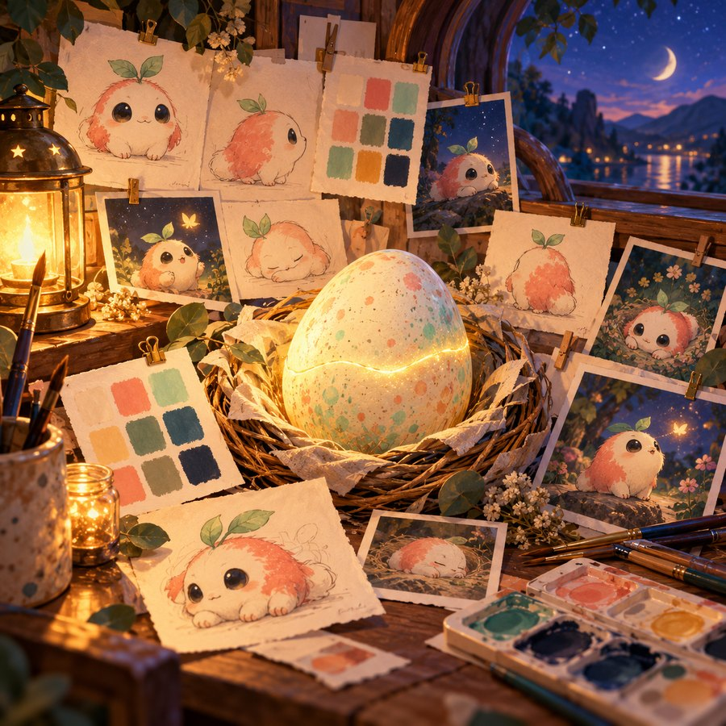
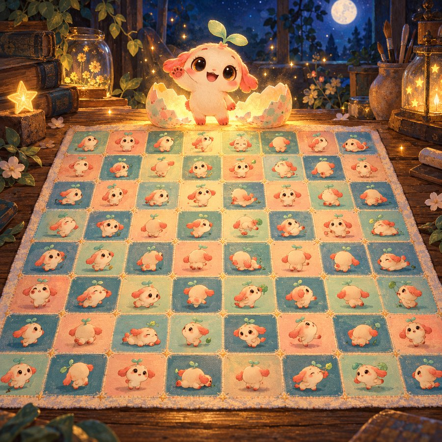
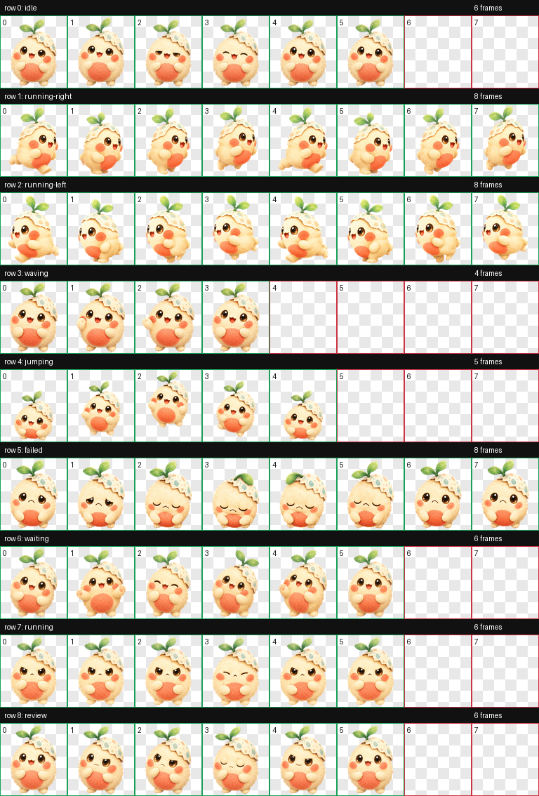
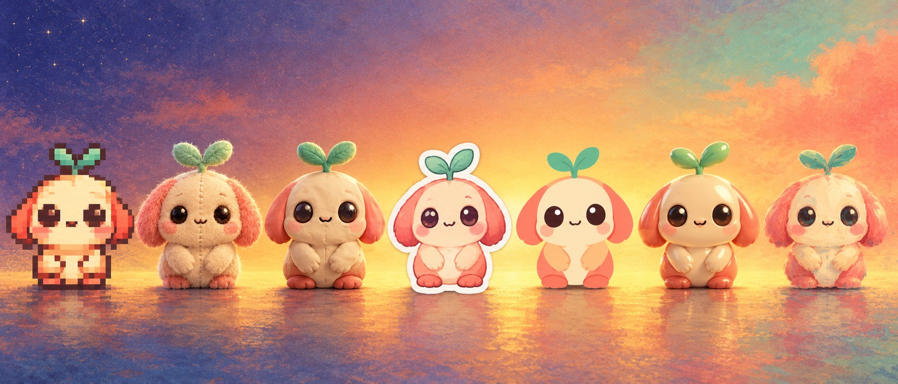

<div align="center">




**A Codex skill for animated pets, reusable visual assets and layered 2D cast production.**<br>
Start with a concept, brand, sketch, or existing artwork. Generate through the installed imagegen skill or import explicitly, validate and visually review, then export or create a local package.

<br>


<sub><i>Meet <b>Pip</b>, who was hatched <b>by this skill</b> to star in its own README. Every frame above came out of the pipeline below.</i></sub>

</div>

<br>

## 🥚 The story of a hatch

<table>
<tr>
<td width="50%" valign="top">

</td>
<td width="50%" valign="top">

### Chapter I · Getting ready
A name, a description, reference art, and a style become a durable request. Brand research retains source attribution and separates inferred guidance from explicit user constraints.

### Chapter II · Imagining the main look
`$imagegen` paints the **canonical base**, a single portrait that every later frame has to match.

### Chapter III · Picturing the poses
Each state gets an animation strip grounded in the base, original references, and a layout guide. Generation can be sequential or delegated when authorized.

### Chapter IV · Hatching
Deterministic scripts preserve motion, validate provenance, compose the atlas, and render review assets. A passing visual review precedes packaging and optional installation.

</td>
</tr>
</table>

<div align="center">




</div>

<br>

## 🎞️ Nine states, one personality

Codex reads one fixed atlas: **8 columns × 9 rows** of `192×208` cells. Each row is a mood the app can show.

<div align="center">
<table>
<tr>
<td align="center"><br><code>idle</code><br><sub>breathing, blinking</sub></td>
<td align="center"><br><code>running-right</code><br><sub>off to the right</sub></td>
<td align="center"><br><code>running-left</code><br><sub>and back again</sub></td>
</tr>
<tr>
<td align="center"><br><code>waving</code><br><sub>hello!</sub></td>
<td align="center"><br><code>jumping</code><br><sub>lift, peak, land</sub></td>
<td align="center"><br><code>failed</code><br><sub>it happens</sub></td>
</tr>
<tr>
<td align="center"><br><code>waiting</code><br><sub>needs your input</sub></td>
<td align="center"><br><code>running</code><br><sub>hard at work</sub></td>
<td align="center"><br><code>review</code><br><sub>looking closely</sub></td>
</tr>
</table>
</div>

<details>
<summary><b>🧵 See the whole atlas Pip was stitched into</b></summary>
<br>
<div align="center">

</div>

| Row | State | Frames | Timing |
| ---: | --- | ---: | --- |
| 0 | `idle` | 6 | 280 · 110 · 110 · 140 · 140 · 320 ms |
| 1 | `running-right` | 8 | 120 ms, last 220 ms |
| 2 | `running-left` | 8 | 120 ms, last 220 ms |
| 3 | `waving` | 4 | 140 ms, last 280 ms |
| 4 | `jumping` | 5 | 140 ms, last 280 ms |
| 5 | `failed` | 8 | 140 ms, last 240 ms |
| 6 | `waiting` | 6 | 150 ms, last 260 ms |
| 7 | `running` | 6 | 120 ms, last 220 ms |
| 8 | `review` | 6 | 150 ms, last 280 ms |

Unused cells stay perfectly transparent. The final atlas is `1536×1872`.
</details>

### 🐣 Inspect Pip

Pip is the bundled historical sample artwork. Check its atlas geometry locally:

```powershell
python scripts/validate_atlas.py assets/pet/spritesheet.webp
```

That check does not recreate generation provenance or prove current app integration. New runs use the review and packaging gates described in [the workflow](references/workflow.md).

<br>

## 🎨 Any style, as long as it's pet-safe

<div align="center">


`pixel` · `plush` · `clay` · `sticker` · `flat-vector` · `3d-toy` · `painterly` · `brand-inspired` · `auto`
</div>

Pixel art is one option. The Codex profile requires a **compact, readable silhouette** at `192×208`, a **consistent face, palette, and props** across nine rows, and a clean transparent background. Existing alpha is preserved; chroma handling is available after checking the selected base. Custom profiles can explicitly permit detached character details.

<br>

## 🚀 Hatch your own

Install the skill into Codex:

```bash
git clone https://github.com/CompleteDotTech/hatch-pet "${CODEX_HOME:-$HOME/.codex}/skills/hatch-pet"
```

Then just ask:

```text
Use $hatch-pet to hatch a sleepy otter barista in a plush style.
```
```text
Use $hatch-pet to make a mascot pet for Acme Robotics.
```
```text
Use $hatch-pet on ./ref/my-cat.png. Clay style, please.
```

Choose a new local run and package location. Package creation is separate from installing into Codex:

```text
chosen-package-directory/
├── pet.json
└── spritesheet.webp
```

Packages also retain profile, review, metrics, and export metadata. [Cross-platform commands](references/workflow.md) cover preparation, generation handoffs, resume, repair, review, export, packaging, optional installation, rollback, and cleanup.

For other applications, see [profiles and exports](references/profiles-and-exports.md). The ten existing character examples remain supported. Ten new [purpose-specific presets and recipes](references/additional-uses.md) cover assembly cards, educational processes, product variants, flipbooks/zoetropes, communication boards, perception stimuli, graphics regression fixtures, animated cursors, protocols and craft grids. They reuse shared print, data, browser, cursor and grid exporters.

The revised pipeline adds [explicit imports and structured identity](references/sources-and-identity.md), [source-bound extraction annotations and a local review desk](references/extraction-and-review.md), [portable archives and operational budgets](references/portability-and-operations.md), and [bounded state-machine playback](references/playback-and-extensions.md). Exported files, local adapter tests and external integrations are reported separately; these examples do not establish live integrations.

```powershell
python scripts/doctor.py
python scripts/demonstrate.py --all --output-dir output/capability-demos
python -m unittest discover -s tests -v
```

Each demonstration produces real inspectable files, a review desk and `acceptance.json`. All demonstrations are explicitly synthetic fixtures, with no model calls or live installation. [Traceability and validation](references/traceability.md) maps every requirement to evidence.

See [the local delivery validation report](references/validation-results.md) for the current regression results, compatibility notes and remaining operating limits.

<br>

## 🎬 Reuse a cast across scenes


The production workflow adds versioned projects and casts, layered character construction, independent performance tracks, reusable motion clips, coordinated props, scenes and cameras, deterministic PNG/PCM rendering, and scoped review history. It builds on the existing imagegen claim, identity, source and repair contracts.

**Milo and Luma** demonstrate the workflow with original, non-fixture artwork: a **36-second seed exchange** with entrances, walking and stopping, dialogue, reactions, a shared prop handoff, camera cuts and exits; then a **22-second garden scene** reusing the same cast and existing clips. Their 20 authored clips and editable dialogue use one shared character version per identity. The production rig is frontal; the four-view design references do not imply that side or back animation rigs exist.

Start with the [production recipe](references/production-pilot.md) to restore the exact artwork and original speech, reconstruct the editable project, render both scenes, inspect them, review changes and export the editor handoff. The [demonstration index](examples/production-pilot/README.md) separates source provenance, actual artwork inspection, offline timing, adapter verification and application integration. [Production validation](references/production-validation.md) records the current results and limitations; [P01–P15 traceability](references/production-traceability.md) maps the requirements to code, tests and evidence.

**Current delivery limitation:** both films and the complete project are validated locally, but automatic approval review has blocked publication of specific artwork and TTS source parts, plus textual review-history parts. Fresh-clone reconstruction of the production pilot requires those remaining parts; [delivery status](DELIVERY_STATUS.md) records the public branch boundary and pending approval. The synthetic workflow below uses no model calls or pilot media.

For a complete model-free regression demonstration:

```bash
python scripts/production_regression_demo.py --output-dir output/production-fixture --movie
python scripts/production.py --help
python -m unittest discover -s tests -v
```

The synthetic demonstration covers three scenes and individually drawn full-frame overrides as well as layered acting. Its generated acceptance records are explicitly synthetic. The local preview supports scrubbing, stepping, audio seeking, track visibility and pinned comparisons; exact final timing comes from offline frames and PCM. The supported editor handoff exports PNG/WAV and layered OpenRaster snapshots for Krita. An adapter roundtrip is reported separately from actually running an available Krita installation.

The fixed Codex atlas, millisecond timing, example profiles and package/install behavior remain unchanged. Scene production does not install anything into a live application.

## ⚙️ Under the shell

```mermaid
flowchart LR
    A([💡 idea · brand · reference]) --> B[hatch.py prepare<br/>profile + prompts + layout guides]
    B --> C[[🎨 $imagegen<br/>canonical base]]
    C --> D[[🎨 $imagegen ×9<br/>row strips]]
    D -->|explicit approved mirror| E[hatch.py derive]
    D --> F[extract_strip_frames.py]
    E --> F
    F --> G[inspect_frames.py]
    G --> H[compose_atlas.py]
    H --> I[validate_atlas.py]
    I --> J[make_contact_sheet.py<br/>render_animation_previews.py]
    J --> K{👀 visual QA}
    K -->|fail: repair one row| D
    K -->|pass| L([🐣 pet.json + spritesheet.webp])
```



| Script | Job |
| --- | --- |
| `scripts/hatch.py` | Locked lifecycle, imagegen/import handoffs, identity, review, archives, budgets, packaging and optional install/rollback |
| `scripts/profile_spec.py` | Validates the single versioned animation contract |
| `scripts/prepare_pet_run.py` | Prepares profile-driven prompts, constraints, layout guides and jobs |
| `scripts/derive_running_left_from_running_right.py` | Compatibility wrapper for approved controller mirroring |
| `scripts/extract_strip_frames.py` | Conservative slots, shared viewport/scale, masking and hash provenance |
| `scripts/inspect_frames.py` | Exact files/provenance, geometry, temporal and consistency measurements |
| `scripts/compose_atlas.py` | Builds the `1536×1872` PNG + WebP atlas |
| `scripts/validate_atlas.py` | Checks geometry, used and unused cells, and transparency |
| `scripts/make_contact_sheet.py` | Lays out every frame on one sheet for a human-eye check |
| `scripts/render_animation_previews.py` | Renders one GIF per row so motion can be judged |
| `scripts/export_assets.py` | Frames, atlas, stills, GIF/WebP and bounded browser state-machine playback |
| `scripts/asset_exporters.py` | Printable cards, flipbooks, boards, stimuli, Xcursor and craft grids |
| `scripts/demonstrate.py` | Ten labeled deterministic demonstrations and acceptance checks |
| `scripts/production.py` | Project/cast validation, coverage, generation bindings, versioned imports, scoped reviews, impact, rendering and archive CLI |
| `scripts/production_contracts.py` / `production_performance.py` | Portable cast/clip/scene contracts, independent tracks, motion, dialogue, interaction and continuity evaluation |
| `scripts/production_render.py` / `production_adapter.py` | Deterministic PNG/PCM masters, resumable rendering, local preview and tested PNG/WAV/OpenRaster handoff |
| `scripts/production_demo.py` / `production_regression_demo.py` | Retained production-art pilot and separate model-free regression scenes |
| `scripts/production_sources.py` / `production_bundle.py` | Exact source transport and verified complete-project bundle transport |

**Design principles**

- 🧠 **Models paint, scripts measure.** Image models never decide atlas geometry. Deterministic code does.
- 🪶 **One claim per generated image** prevents duplicate generation. A reviewer sees all states and actual timed playback.
- 🔒 **Identity evidence.** Every row retains canonical references and structured requirements. Visual review must reject drift even when automated checks pass.
- 🩹 **Repair the row, not the sheet.** A failure regenerates only the smallest scope that broke.

More detail lives in [`SKILL.md`](SKILL.md), [`references/animation-rows.md`](references/animation-rows.md), [`references/codex-pet-contract.md`](references/codex-pet-contract.md) and [`references/qa-rubric.md`](references/qa-rubric.md).

Run `python -m unittest discover -s tests -v` for the complete local regression suite, including model-free reconstruction checks against retained non-fixture pilot sources. These tests do not call imagegen or confer artwork approval. `python tests/fixture_workflow.py --output-dir C:/work/hatch-fixture-demo --profile examples/web-status.json` creates a clearly labeled legacy demonstration without calling imagegen or installing a pet.

The complete development suite uses `requirements-test.txt` and a local Playwright Chromium binary. Install them if missing with `python -m pip install -r requirements-test.txt` and `python -m playwright install chromium`. The standalone `scripts/doctor.py` reports local capabilities without requiring browser tools.

<br>

<div align="center">


<sub>Imported from <a href="https://github.com/openai/skills">openai/skills</a> · see <a href="LICENSE.txt">LICENSE.txt</a> · art painted by Codex <code>$imagegen</code> · Pip hatched by <code>hatch-pet</code> itself</sub>
</div>
